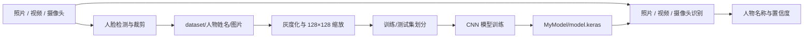

# CNN_FacesRecognition

**基于 CNN 的人脸数据采集、模型训练与图片/视频/摄像头识别。**

<p align="center">
  <a href="https://github.com/panvv-ai/CNN_FacesRecognition/actions/workflows/ci.yml">
    
  </a>
  
  
  
</p>

<p align="center">
  <a href="README.md">简体中文</a> | <a href="README.en.md">English</a>
</p>

一个使用卷积神经网络（CNN）完成人脸数据采集、模型训练和图片/视频/摄像头推理的 Python 项目。项目适合学习计算机视觉与深度学习的基本工作流，也可作为小型人脸识别原型的起点。

## 目录

- [项目简介](#项目简介)
- [主要功能](#主要功能)
- [技术栈](#技术栈)
- [工作流程](#工作流程)
- [项目结构](#项目结构)
- [环境要求](#环境要求)
- [快速开始](#快速开始)
- [数据规范](#数据规范)
- [配置说明](#配置说明)
- [测试与持续集成](#测试与持续集成)
- [隐私与安全](#隐私与安全)
- [已知限制](#已知限制)
- [参与贡献](#参与贡献)
- [许可证](#许可证)

## 项目简介

本项目提供一条从原始照片到可运行识别模型的完整链路：

1. 从照片、视频或摄像头中检测并裁剪人脸。
2. 按人物目录组织训练数据并自动生成分类标签。
3. 使用 TensorFlow/Keras 构建和训练 CNN 分类模型。
4. 使用已训练模型识别照片、视频和实时摄像头画面。

模型输入为 `128 × 128` 灰度人脸图像，输出为人物类别索引和对应置信度。摄像头与视频识别默认将置信度低于 `0.70` 的结果标记为 `unknown`。

## 主要功能

| 模块 | 脚本 | 功能 |
| --- | --- | --- |
| 照片采集 | `faces_from_Photo.py` | 使用 OpenCV Haar 分类器从照片目录检测并裁剪人脸 |
| 视频采集 | `faces_from_Video.py` | 使用 Dlib HOG 检测器从视频文件中采集人脸 |
| 摄像头采集 | `faces_from_Camera.py` | 从摄像头实时采集人脸，并进行随机亮度/对比度增强 |
| 数据处理 | `load_dataset.py`、`dataSet.py` | 读取图片、生成标签、灰度化、缩放、标准化及训练集划分 |
| 模型训练 | `train_model.py` | 构建、训练、评估并保存 CNN 模型 |
| 照片识别 | `Recognize_From_Photo.py` | 对单张或批量照片进行人脸识别 |
| 视频识别 | `Recognize_From_Vedio.py` | 在视频帧中检测并标注人脸 |
| 摄像头识别 | `Recognize_From_Camera.py` | 实时显示摄像头检测和识别结果 |
| 自动化验证 | `tests/`、GitHub Actions | 校验训练、保存、重载和预测主链路 |

### 模型结构

```text
Input(128 × 128 × 1)
  -> Conv2D(32, 5 × 5, ReLU) -> MaxPooling2D
  -> Conv2D(64, 5 × 5, ReLU) -> MaxPooling2D
  -> Flatten
  -> Dense(512, ReLU)
  -> Dense(num_classes, Softmax)
```

## 技术栈

- Python 3.11+
- TensorFlow / Keras
- OpenCV
- scikit-learn
- NumPy
- Dlib（仅视频和摄像头数据采集）

依赖版本固定记录在 [`requirements.txt`](requirements.txt) 中；Dlib 单独放在 [`requirements-face-detection.txt`](requirements-face-detection.txt)。

## 工作流程



## 项目结构

```text
.
├── .github/
│   ├── dependabot.yml
│   └── workflows/ci.yml
├── dataset/                    # 训练数据：dataset/<人物姓名>/*.jpg
├── model_test/                 # 待识别照片或视频
├── tests/                      # 自动化冒烟测试
├── dataSet.py                  # 数据格式化和标签编码
├── load_dataset.py             # 数据集读取
├── read_img.py                 # 图片目录读取工具
├── train_model.py              # CNN 构建、训练、保存和预测
├── faces_from_Photo.py         # 从照片采集人脸
├── faces_from_Video.py         # 从视频采集人脸
├── faces_from_Camera.py        # 从摄像头采集人脸
├── Recognize_From_Photo.py     # 照片识别
├── Recognize_From_Vedio.py     # 视频识别
├── Recognize_From_Camera.py    # 摄像头实时识别
├── requirements.txt            # 核心依赖
└── requirements-face-detection.txt
```

## 环境要求

- Python 3.11 或更高版本
- macOS、Linux 或 Windows
- 使用视频/摄像头采集功能时，需要可用的摄像头和 Dlib
- 训练和实时识别建议使用支持 TensorFlow 的 CPU 或 GPU

## 快速开始

### 1. 克隆并安装

```bash
git clone https://github.com/panvv-ai/CNN_FacesRecognition.git
cd CNN_FacesRecognition

python3.11 -m venv .venv
source .venv/bin/activate
python -m pip install --upgrade pip
pip install -r requirements.txt
```

Windows PowerShell：

```powershell
.venv\Scripts\Activate.ps1
python -m pip install --upgrade pip
pip install -r requirements.txt
```

仅在需要从视频或摄像头采集人脸时安装 Dlib：

```bash
pip install -r requirements-face-detection.txt
```

Dlib 在没有预编译包的平台上会从源码编译，通常需要 CMake 和 C++ 编译工具链。

### 2. 准备数据

数据按人物姓名分目录保存：

```text
dataset/
├── alice/
│   ├── 0001.jpg
│   └── 0002.jpg
└── bob/
    ├── 0001.jpg
    └── 0002.jpg
```

也可以使用采集脚本生成数据：

```bash
# 从照片目录采集；先创建 ./MySource_faces 和输出目录
python faces_from_Photo.py

# 从视频采集；修改脚本中的视频文件名
python faces_from_Video.py

# 从摄像头采集；将 cv2.VideoCapture(700) 中的设备编号改为常见值 0
python faces_from_Camera.py
```

采集脚本中的源路径、目标路径、视频文件名和摄像头编号按本机环境修改。

### 3. 训练模型

```bash
python train_model.py
```

训练完成后，模型默认保存到 `MyModel/model.keras`。程序会按 `8:2` 划分训练集和测试集，并输出测试集损失和准确率。

### 4. 运行识别

```bash
# 批量识别 model_test/ 下的照片
python Recognize_From_Photo.py

# 识别视频；在脚本中指定视频路径
python Recognize_From_Vedio.py

# 摄像头实时识别；按需调整摄像头编号
python Recognize_From_Camera.py
```

识别脚本会从 `dataset/` 的子目录名称恢复人物名称，因此训练数据和识别阶段应使用相同的数据目录结构。

## 数据规范

- 每个子目录表示一个人物类别，目录名即显示名称。
- 当前数据加载器只读取 `.jpg` 文件。
- 图片应包含清晰、可检测的人脸；建议采集不同光照、角度和表情的样本。
- 训练阶段会自动转换为灰度图并缩放到 `128 × 128`。
- 不建议把原始人脸照片、模型文件或本地缓存提交到 Git。

## 配置说明

| 配置项 | 位置 | 默认值 |
| --- | --- | --- |
| 输入尺寸 | `train_model.py` | `128 × 128` |
| 训练轮数 | `train_model.py` | `8` |
| 批大小 | `train_model.py` | `20` |
| 模型文件 | `train_model.py` | `./MyModel/model.keras` |
| 未知人脸阈值 | `Recognize_From_Camera.py`、`Recognize_From_Vedio.py` | `0.70` |
| 采集数量 | `faces_from_Video.py`、`faces_from_Camera.py` | `200` |
| 摄像头设备编号 | `faces_from_Camera.py`、`Recognize_From_Camera.py` | `700` |

## 测试与持续集成

本地运行：

```bash
python -m unittest discover -s tests -v
```

测试会生成临时数据集，完成一轮训练、模型保存、重新加载和预测，确认核心链路可用。

GitHub Actions 在每次 PR 和 `master` 分支推送时运行相同的检查。工作流定义见 [`.github/workflows/ci.yml`](.github/workflows/ci.yml)。

## 隐私与安全

人脸图像属于敏感个人信息。使用或发布本项目中的数据、模型和识别结果前，应确保：

- 已取得当事人明确授权，或具有其他合法处理依据。
- 遵守所在地关于个人信息、生物识别和人脸识别的法律法规。
- 不将本项目直接用于未经告知的监控、身份核验或高风险决策。
- 不公开上传真实人员照片、模型权重、密钥或运行日志。

仓库内现有示例照片仅用于演示程序流程。维护者应定期确认这些素材是否仍有公开授权。

## 已知限制

- 当前模型是基础 CNN 分类器，不具备活体检测、防伪或跨年龄识别能力。
- 人脸检测依赖 Haar/HOG，遮挡、小脸和极端光照条件下效果有限。
- 数据集较小时容易过拟合，模型准确率不代表生产环境性能。
- 摄像头编号、文件路径和部分训练参数目前写在脚本中，需要手动修改。
- 项目尚未提供预训练模型、打包安装包或图形界面。

## 参与贡献

欢迎提交 issue 和 pull request：

1. 从 `master` 创建功能分支。
2. 保持改动聚焦，并补充或更新测试。
3. 运行 `python -m unittest discover -s tests -v`。
4. 提交 PR，等待 CI 通过和代码审核。

`master` 分支应保持可构建、可测试和可回滚。禁止直接推送、强制推送或删除主分支。

## 许可证

本仓库目前尚未声明开源许可证。在许可证明确之前，默认版权归仓库作者所有；复制、修改、分发或商业使用前，请先取得权利人的明确许可。

---

维护者博客：<https://www.cnblogs.com/panweiwei/>
