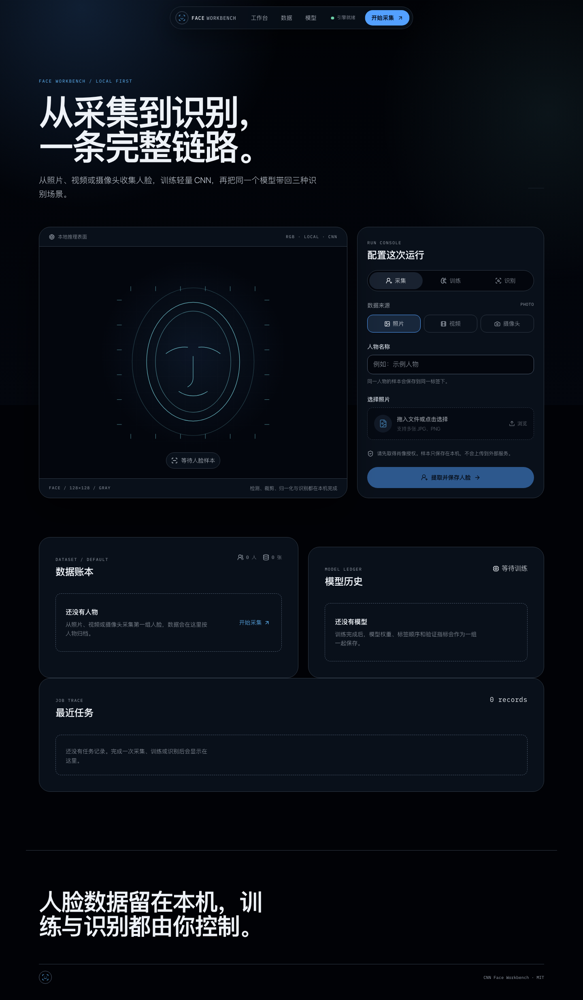

# Face Workbench

**本地优先的人脸采集、CNN 训练与识别工作台。**

<p align="center">
  <a href="https://github.com/panvv-ai/CNN_FacesRecognition/actions/workflows/ci.yml">
    
  </a>
  
  
  
</p>

<p align="center">
  <a href="README.md">简体中文</a> | <a href="README.en.md">English</a>
</p>

Face Workbench 将照片、视频和浏览器摄像头三种人脸数据来源收束到同一个产品工作台。用户可以采集和整理人脸样本、训练轻量 CNN 分类模型，并使用同一组模型完成照片、视频及实时摄像头识别。

应用采用本地单用户架构：图片、视频和模型权重保存在本机文件系统，SQLite 只保存数据集、模型、任务和标签映射等元数据。

> [!IMPORTANT]
> 本项目适合学习、演示和本地原型验证，不是生产级身份核验、活体检测或监控系统。采集和使用人脸数据前，必须取得当事人明确授权。

## 产品功能

<p align="center">
  
</p>

<p align="center">
  <sub>截图使用独立空白数据库生成，不包含真实姓名或人脸图像。</sub>
</p>

- **三种数据来源**：支持批量照片、视频隔帧采样和浏览器摄像头实时采集。
- **统一识别链路**：所有来源共用 OpenCV 人脸检测、128 × 128 灰度预处理、CNN 分类和阈值判断。
- **采集结果可见**：摄像头停止后自动刷新数据统计，并提示本次新增及重复样本数量。
- **数据管理**：已保存人物可继续采集、浏览人脸缩略图、删除单张样本或删除整个人物。
- **模型版本管理**：保存模型权重、排序后的标签、阈值、验证指标和随机种子，支持切换历史模型。
- **多场景识别**：支持单张/批量照片、带进度视频任务和浏览器摄像头实时框选。
- **本地任务记录**：训练和批量识别任务持久化到 SQLite，服务重启时不会伪装成仍在运行。
- **产品化界面**：React 工作台提供真实数据集、模型指标、任务状态和结果下载。

## 技术栈

| 层级 | 技术 |
| --- | --- |
| 后端 API | Python 3.11、FastAPI、Uvicorn、Pydantic |
| 人脸视觉 | OpenCV Haar 检测、裁剪、灰度化和标注 |
| 模型训练 | TensorFlow / Keras CNN、NumPy、scikit-learn |
| 数据层 | SQLAlchemy 2、Alembic、SQLite |
| 前端 | React 19、TypeScript、Vite、TanStack Query |
| 质量保障 | pytest、ruff、mypy、ESLint、Vitest、Playwright |

## 快速开始

### 环境要求

- Python 3.11
- Node.js 22+
- pnpm 10+

### 安装与启动

```bash
git clone https://github.com/panvv-ai/CNN_FacesRecognition.git
cd CNN_FacesRecognition

uv sync --extra dev
pnpm --dir frontend install
pnpm --dir frontend build

uv run python main.py
```

启动后打开：

- 产品页面：<http://127.0.0.1:8000>
- API 文档：<http://127.0.0.1:8000/docs>
- 健康检查：<http://127.0.0.1:8000/api/health>

如需前端热更新，可另开终端运行：

```bash
pnpm --dir frontend dev
```

Vite 会把 REST API 和摄像头 WebSocket 代理到本地 FastAPI 服务。

## 使用方式

### 1. 采集人脸

1. 在页面选择“采集”。
2. 选择“照片”“视频”或“摄像头”。
3. 填写人物名称并开始采集。
4. 摄像头停止后，系统会自动刷新数据集并提示保存结果。

同一个人的照片应放在同一人物名称下。训练至少需要两个人，每人至少两张可读人脸。

### 2. 整理数据

在“数据账本”中：

- “继续采集”会打开该人物对应的摄像头采集流程。
- “管理样本”展示已保存的人脸缩略图，可逐张删除。
- “删除”移除该人物的全部原始人脸文件和数据库记录。

删除样本不会自动删除已经训练出的模型权重。

### 3. 训练模型

进入“训练”，确认数据集状态后创建模型。首个成功模型会自动启用，后续训练会保留历史版本。

### 4. 识别人脸

进入“识别”，选择模型和数据来源：

- 照片：返回带人脸框、姓名和置信度的标注图。
- 视频：后台任务处理并提供带进度输出。
- 摄像头：浏览器实时取帧，在扫描舞台叠加识别结果。

低于模型阈值的结果显示为 `Unknown`。

### 5. 导入旧数据

```bash
uv run python main.py import-legacy --source dataset
```

导入过程会复制检测后的人脸样本，不会修改旧目录中的原始文件。

## 命令行

| 命令 | 用途 |
| --- | --- |
| `uv run python main.py` | 启动本地 Web 产品 |
| `uv run python main.py serve` | 显式启动 Web 服务 |
| `uv run python main.py db-upgrade` | 升级 SQLite 数据库结构 |
| `uv run python main.py import-legacy --source dataset` | 导入旧数据集 |
| `uv run python main.py collect --source photo --person Alice --input ./photos` | 从照片采集 |
| `uv run python main.py collect --source video --person Alice --input ./video.mp4` | 从视频采集 |
| `uv run python main.py collect --source camera --person Alice` | 从本机摄像头采集 |
| `uv run python main.py train` | 训练并保存模型 |
| `uv run python main.py recognize --source photo --input ./target.jpg` | 识别照片 |
| `uv run python main.py recognize --source video --input ./target.mp4` | 识别视频 |
| `uv run python main.py recognize --source camera` | 打开本机摄像头识别 |

## 项目结构

```text
.
├── main.py                     # 统一产品入口
├── src/face_workbench/
│   ├── domain/                 # 领域类型与输入规范化
│   ├── vision/                 # 人脸检测、裁剪与图像处理
│   ├── ml/                     # CNN 训练、模型加载与元数据
│   ├── db/                     # SQLAlchemy 模型与仓储
│   ├── services/               # 采集、训练、识别、任务和数据管理
│   ├── api/                    # FastAPI、WebSocket 和静态页面
│   └── cli.py                  # 统一命令行入口
├── frontend/                   # React + TypeScript + Vite
├── migrations/                 # Alembic 数据库迁移
├── docs/                       # 架构、模型卡、隐私和数据库文档
├── tests/                      # Python 单元与集成测试
└── storage/                    # 运行时数据，不提交到 Git
```

更多设计说明见 [架构文档](docs/architecture.md)。

## 数据与隐私

默认运行时目录：

```text
storage/
├── face_workbench.sqlite3
├── datasets/default/faces/<姓名>/*.jpg
├── models/<model-id>/
├── uploads/<job-id>/
└── outputs/<job-id>/
```

- 服务默认只监听 `127.0.0.1`。
- 人脸图片、标签、模型和识别结果不会上传到外部服务。
- `storage/`、模型文件、SQLite 数据库和上传输出均被 `.gitignore` 排除。
- 缩略图接口只允许按已登记样本 ID 读取，不暴露整个存储目录。
- 删除原始样本不会自动清理历史模型中的已学习参数。

使用前请阅读 [隐私说明](docs/privacy.md)；模型适用范围和限制见 [模型卡](docs/model-card.md)。

## 配置

复制 [`.env.example`](.env.example) 为 `.env`，或直接使用环境变量：

| 变量 | 默认值 | 说明 |
| --- | --- | --- |
| `FACE_WORKBENCH_HOST` | `127.0.0.1` | 服务监听地址 |
| `FACE_WORKBENCH_PORT` | `8000` | 服务监听端口 |
| `FACE_WORKBENCH_STORAGE_DIR` | `./storage` | 本机数据目录 |
| `FACE_WORKBENCH_DATABASE_URL` | SQLite 默认路径 | SQLAlchemy 数据库连接 |
| `FACE_WORKBENCH_THRESHOLD` | `0.70` | 未知人脸判定阈值 |
| `FACE_WORKBENCH_CAMERA_FRAME_EDGE` | `960` | 浏览器摄像头最长边像素 |

## 开发与测试

```bash
uv run pre-commit install

uv run ruff check src tests scripts main.py *.py
uv run mypy
uv run pytest

pnpm --dir frontend lint
pnpm --dir frontend typecheck
pnpm --dir frontend test:run
pnpm --dir frontend test:e2e
pnpm --dir frontend build
```

首次运行 Playwright 前需安装浏览器：

```bash
pnpm --dir frontend exec playwright install chromium
```

CI 会检查后端 lint、类型、数据库迁移和测试，以及前端 lint、类型、单元测试、生产构建和端到端测试。

## CodeGraph

仓库支持 CodeGraph 本地索引：

```bash
codegraph init .
codegraph status
codegraph explore "RecognitionService TrainingService"
```

`.codegraph/` 是本地生成的 SQLite 索引，不提交到版本库。

## 兼容入口

根目录的 `faces_from_*.py`、`Recognize_From_*.py`、`dataSet.py`、`load_dataset.py`、`read_img.py` 和 `train_model.py` 保留为旧入口或兼容导出。新项目和新脚本应统一使用 `python main.py`。

## 已知限制

- Haar 检测对遮挡、小脸、侧脸和极端光照有限。
- 小型 CNN 在数据量不足时容易过拟合。
- 不具备活体检测、防伪、跨年龄识别或大规模人脸检索能力。
- 实时摄像头性能受浏览器权限、设备性能和帧压缩影响。
- 远程 HTTPS 和多用户部署不在当前版本范围内。

## 贡献

提交代码前请阅读 [贡献指南](CONTRIBUTING.md)、[安全策略](SECURITY.md) 和 [行为准则](CODE_OF_CONDUCT.md)。

## 开源协议

Copyright © 2026 CNN_FacesRecognition contributors.

本项目采用 [MIT License](LICENSE)。在保留版权声明和许可声明的前提下，允许使用、复制、修改、合并、发布、分发、再许可和销售本软件。

本软件按 **“AS IS”** 提供，不附带任何明示或默示担保，包括但不限于适销性、特定用途适用性和非侵权担保。作者或版权持有人不对因使用本软件产生的任何索赔、损害或其他责任负责。
