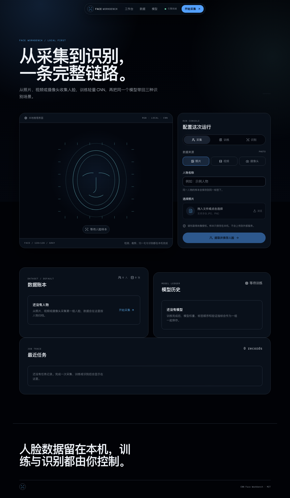

# Face Workbench

**A local-first workbench for face collection, CNN training, and recognition.**

<p align="center">
  <a href="https://github.com/panvv-ai/CNN_FacesRecognition/actions/workflows/ci.yml">
    
  </a>
  
  
  
</p>

<p align="center">
  <a href="../README.md">简体中文</a> | <a href="README.en.md">English</a>
</p>

Face Workbench brings photo, video, and browser-camera face sources into one
local workbench. Collect and organize face samples, train a lightweight CNN
classifier, and use the same model set for photo, video, and live camera
recognition.

The application is local-first and single-user. Image, video, and model files
stay on the local filesystem; SQLite stores only dataset, model, job, and label
metadata.

> [!IMPORTANT]
> This project is intended for learning, demonstrations, and local prototypes.
> It is not production identity verification, liveness detection, or
> surveillance software. Obtain explicit consent before collecting or
> processing face images.

## Product features

<p align="center">
  
</p>

<p align="center">
  <sub>The screenshot was generated from an isolated empty database and contains no real names or face images.</sub>
</p>

- **Three input sources:** batch photos, sampled video frames, and browser-camera capture.
- **One recognition pipeline:** OpenCV detection, 128 × 128 grayscale preprocessing, CNN classification, and thresholding.
- **Visible collection results:** stopping the camera refreshes statistics and reports new versus duplicate samples.
- **Dataset management:** continue collection, inspect thumbnails, delete individual samples, or remove a person.
- **Model versioning:** persist weights, ordered labels, thresholds, metrics, and random seeds; activate historical models.
- **Multi-scenario recognition:** photos, progress-tracked video jobs, and live browser-camera overlays.
- **Persistent local jobs:** training and batch recognition jobs survive in SQLite and interrupted work is reported honestly.
- **Product UI:** a responsive React workbench with real dataset, model, job, and output state.

## Technology

| Layer | Stack |
| --- | --- |
| Backend API | Python 3.11, FastAPI, Uvicorn, Pydantic |
| Face vision | OpenCV Haar detection, cropping, grayscale conversion, annotation |
| Model training | TensorFlow / Keras CNN, NumPy, scikit-learn |
| Data layer | SQLAlchemy 2, Alembic, SQLite |
| Frontend | React 19, TypeScript, Vite, TanStack Query |
| Quality | pytest, ruff, mypy, ESLint, Vitest, Playwright |

## Quick start

### Requirements

- Python 3.11
- Node.js 22+
- pnpm 10+

### Install and run

```bash
git clone https://github.com/panvv-ai/CNN_FacesRecognition.git
cd CNN_FacesRecognition

uv sync --extra dev
pnpm --dir frontend install
pnpm --dir frontend build

uv run python main.py
```

Open:

- Product UI: <http://127.0.0.1:8000>
- API documentation: <http://127.0.0.1:8000/docs>
- Health check: <http://127.0.0.1:8000/api/health>

For frontend hot reload:

```bash
pnpm --dir frontend dev
```

## Usage

### Collect faces

1. Select **Collect**.
2. Choose **Photo**, **Video**, or **Camera**.
3. Enter a person name and start collection.
4. Stop the camera to trigger an automatic dataset refresh and save report.

Training requires at least two people and at least two readable face samples per
person.

### Manage saved data

In the dataset ledger:

- **Continue collection** opens the camera workflow with that person selected.
- **Manage samples** shows saved face thumbnails and supports individual deletion.
- **Delete** removes all raw face files and database records for that person.

Deleting source samples does not automatically remove previously trained model
weights.

### Train and recognize

- **Train** creates a model; the first successful model is activated automatically.
- **Recognize** accepts photos, videos, or a live browser camera.
- Results below the model threshold are labelled `Unknown`.

### Import an existing dataset

```bash
uv run python main.py import-dataset --source /path/to/photos-by-person
```

The source directory must use `<person>/<image>` layout. Files are detected,
cropped, and copied into application storage. Original files are not modified.

## CLI

| Command | Purpose |
| --- | --- |
| `uv run python main.py` | Start the local web product |
| `uv run python main.py serve` | Explicitly start the web server |
| `uv run python main.py db-upgrade` | Upgrade the SQLite schema |
| `uv run python main.py import-dataset --source <directory>` | Import an existing person/image dataset |
| `uv run python main.py collect --source photo --person Alice --input ./photos` | Collect from photos |
| `uv run python main.py collect --source video --person Alice --input ./video.mp4` | Collect from video |
| `uv run python main.py collect --source camera --person Alice` | Collect from the local camera |
| `uv run python main.py train` | Train and save a model |
| `uv run python main.py recognize --source photo --input ./target.jpg` | Recognize a photo |
| `uv run python main.py recognize --source video --input ./target.mp4` | Recognize a video |
| `uv run python main.py recognize --source camera` | Recognize from the local camera |

## Project layout

```text
.
├── main.py                     # Unified product entrypoint
├── src/face_workbench/
│   ├── domain/                 # Domain types and validation
│   ├── vision/                 # Detection, cropping, image processing
│   ├── ml/                     # CNN training and model metadata
│   ├── db/                     # SQLAlchemy models and repositories
│   ├── services/               # Collection, training, recognition, jobs, management
│   ├── api/                    # FastAPI, WebSocket, static SPA
│   └── cli.py                  # Typer command-line interface
├── frontend/                   # React + TypeScript + Vite
├── config/                     # Local environment example
├── migrations/                 # Alembic migrations
├── docs/                       # Architecture, privacy, model card, database docs
├── tests/                      # Python unit and integration tests
└── storage/                    # Runtime data, ignored by Git
```

See [architecture.md](architecture.md) for the design.

## Data and privacy

Runtime data defaults to:

```text
storage/
├── face_workbench.sqlite3
├── datasets/default/faces/<name>/*.jpg
├── models/<model-id>/
├── uploads/<job-id>/
└── outputs/<job-id>/
```

- The server binds to `127.0.0.1` by default.
- Face images, labels, models, and outputs are not uploaded to external services.
- Runtime files, databases, model weights, uploads, and outputs are ignored by Git.
- Thumbnail routes only serve registered sample IDs; the whole storage directory is not exposed.
- Deleting a source sample does not erase learned parameters from historical models.

Read [privacy.md](privacy.md) and [model-card.md](model-card.md).

## Configuration

Copy [`config/env.example`](../config/env.example) to `.env`, or use environment variables:

| Variable | Default | Description |
| --- | --- | --- |
| `FACE_WORKBENCH_HOST` | `127.0.0.1` | Listen address |
| `FACE_WORKBENCH_PORT` | `8000` | Listen port |
| `FACE_WORKBENCH_STORAGE_DIR` | `./storage` | Local runtime directory |
| `FACE_WORKBENCH_DATABASE_URL` | SQLite default | SQLAlchemy database URL |
| `FACE_WORKBENCH_THRESHOLD` | `0.70` | Unknown-face threshold |
| `FACE_WORKBENCH_CAMERA_FRAME_EDGE` | `960` | Browser-camera long-edge limit |

## Development and testing

```bash
uv run ruff check src tests scripts main.py *.py
uv run mypy
uv run pytest

pnpm --dir frontend lint
pnpm --dir frontend typecheck
pnpm --dir frontend test:run
pnpm --dir frontend test:e2e
pnpm --dir frontend build
```

Install the Playwright browser once:

```bash
pnpm --dir frontend exec playwright install chromium
```

## CodeGraph

```bash
codegraph init .
codegraph status
codegraph explore "RecognitionService TrainingService"
```

The local `.codegraph/` SQLite index is ignored by Git.

## Known limitations

- Haar detection is limited by occlusion, small or rotated faces, and poor lighting.
- A small CNN can overfit when training data is limited.
- No liveness detection, anti-spoofing, cross-age recognition, or large-scale face retrieval.
- Live camera performance depends on browser permissions, hardware, and frame compression.
- Remote HTTPS and multi-user deployment are outside the current scope.

## Contributing

Read [CONTRIBUTING.md](../.github/CONTRIBUTING.md),
[SECURITY.md](../.github/SECURITY.md), and
[CODE_OF_CONDUCT.md](../.github/CODE_OF_CONDUCT.md) before submitting changes.

## License

Copyright © 2026 CNN_FacesRecognition contributors.

This project is released under the [MIT License](../LICENSE). Subject to preserving
the copyright and permission notices, you may use, copy, modify, merge, publish,
distribute, sublicense, and sell copies of the software.

The software is provided **“AS IS”**, without warranty of any kind, express or
implied, including merchantability, fitness for a particular purpose, and
non-infringement. The authors or copyright holders are not liable for any claim,
damage, or other liability arising from use of the software.
